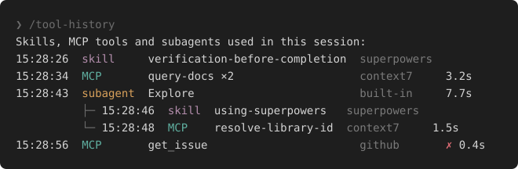

# tool-history

A Claude Code mod that shows which add-on tools the agent actually used in this session: skills, MCP tools and subagents. If a skill or MCP server you expected never shows up, it may not be loaded.

Type `/tool-history` to print the list:



- Each row: time, category, name, source (plugin, MCP server, user, project or built-in), duration.
- Calls a subagent makes are listed under it; the subagent row shows its total time.
- Consecutive calls of the same tool merge into one row with `×N` and the summed time; a failed call stays on its own row, marked with a red `✗`.
- Categories are colored: skill mauve, MCP teal, subagent orange; the source is gray.
- Skills show no duration. A call still in progress shows `running`.
- Built-in tools (Bash, Read, Edit, ...) are not recorded.
- The history lives in memory for the current session only (at most 500 entries) and starts empty after a restart, `/clear` or a resume. Calls made before the mod loaded are not recorded.

## Install

At the prompt of a Claude Code terminal session:

```
/plugin install tool-history --marketplace lush-life/tool-history
```

Answer `y` to add the marketplace, then pick a scope.

From a shell:

```
claude plugin install tool-history --marketplace lush-life/tool-history
```

In the desktop app, where `/plugin` does not run: click + next to the prompt box, then Plugins, Add marketplace with `lush-life/tool-history`, then Add plugin.

## License

MIT
